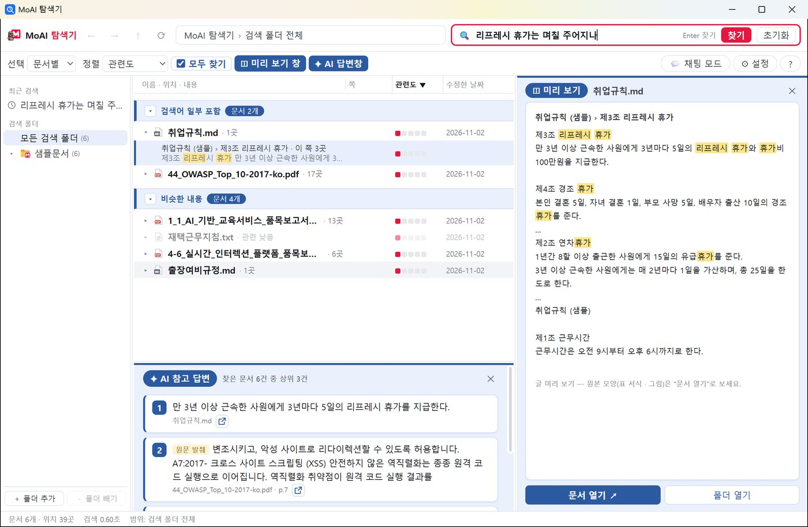

<h1 align="center">MoAI-S</h1>

<b>내 PC 문서를 문장으로 찾고, AI 가 정리해 주는 Windows 데스크톱 검색</b> 
문서는 이 PC 밖으로 나가지 않습니다.

  <a href="https://github.com/kobongsoo/MoAI-S/releases/latest"><b>⬇ 다운로드</b></a> ·
  <a href="https://kobongsoo.github.io/MoAI-S/">소개 사이트</a> ·
  <a href="https://kobongsoo.github.io/MoAI-S/manual.html">사용 설명서</a> ·
  <a href="https://kobongsoo.github.io/MoAI-S/changelog.html">변경 기록</a>

## 무엇을 하나요

- **문장으로 찾기** — “작년 내가 작성한 AI 제안서”처럼 쓰면 그 내용이 있는 **문서 · 쪽 · 해당 부분**을 보여 줍니다.
- **모두 찾기** — 검색어가 든 문서를 모두, *모두 포함 · 일부 포함 · 비슷한 내용*으로 묶어 보여 줍니다.
- **미리 보기** — 쪽을 누르면 그 쪽이(PDF 는 원본 모양으로), 두 번 누르면 문서가 열립니다.
- **AI 참고 답변** — 찾은 문서 상위 3건을 AI 가 한 줄씩 정리합니다.
- **비슷한 문서 찾기** — 문서 하나를 넣으면 내용이 비슷한 문서를 찾아 보여 줍니다(0.1.3).
- **인덱싱 실패 문서 보기** — 설정 > 로그에서 읽지 못한 문서와 까닭을 봅니다(0.1.3).
- **스캔 문서 읽기(OCR)** — 글자층이 없는 스캔 PDF · 그림 파일의 글자를 읽어 검색에 넣습니다(0.1.4). 옆으로 누운 채 스캔된 쪽도 바로 세워 읽고 제목 · 문단 · 머리말을 가립니다(0.1.6).
- **답변 모델 고르기** — 설정 > 모델에서 PC 사양에 맞는 답변 모델을 추천받고 받아 바꿉니다(0.1.4).
- **채팅 모드** — Windows 탐색기 옆 패널에서 문서를 근거로 묻고 답을 받습니다.
- **온디바이스** — 인덱스와 AI 모델이 모두 PC 안에서 돕니다. 인터넷이 없어도 됩니다.

지원 문서: HWP · HWPX · DOC · DOCX · PPT · PPTX · XLS · XLSX · PDF · TXT · MD · CSV · 스캔 PDF · 그림(OCR)

## 설치

1. [최신 릴리스](https://github.com/kobongsoo/MoAI-S/releases/latest)에서 **`MoAISearch_Setup_<버전>.exe`** 를 내려받아 실행합니다(관리자 권한 필요 없음).
2. 처음 실행하면 환영 화면에서 **[📁 검색 폴더 고르기]** 로 문서가 든 폴더를 고릅니다.
3. 문서를 읽는 동안 화면 사용법을 7단계로 안내합니다. 읽은 문서부터 바로 찾을 수 있습니다.

> **“Windows의 PC 보호” 경고** — 코드 서명 전이라 SmartScreen 경고가 나올 수 있습니다. **[추가 정보] → [실행]** 을 누르세요.

### 다른 답변 모델 (선택)

설치 뒤 **설정 > 모델**에서 PC 사양에 맞는 추천을 보고 바로 받습니다(Qwen · Mi:dm · Kanana 등).
회사망 차단 등으로 받기가 안 되면 [답변 모델 릴리스(models-1)](https://github.com/kobongsoo/MoAI-S/releases/tag/models-1)에서
모델별 설치 파일을 직접 받아 실행하세요(1.9GB 를 넘는 모델은 `.exe` 와 `-1.bin` · `-2.bin` 을 같은 폴더에 받습니다).
0.1.3 까지의 정밀 모드 모델 설치 파일은 0.1.4 부터 설정 > 모델로 바뀌었습니다.

## 권장 사양

| 항목 | 내용 |
|---|---|
| 운영체제 | Windows 10 · 11 (64비트) |
| 디스크 | 약 1.5GB (답변 모델마다 +1~3GB) + 문서 인덱스 |
| 그래픽 | 내장 GPU(Vulkan)가 있으면 AI 답이 빨라집니다. 없으면 CPU 로 동작합니다. |

## 라이선스

ⓒ Innotena. All rights reserved.

함께 배포하는 AI 모델과 오픈소스 구성 요소의 라이선스는 [LICENSES_MODELS.txt](LICENSES_MODELS.txt) · [LICENSES_THIRD_PARTY.txt](LICENSES_THIRD_PARTY.txt) 에 있습니다.
